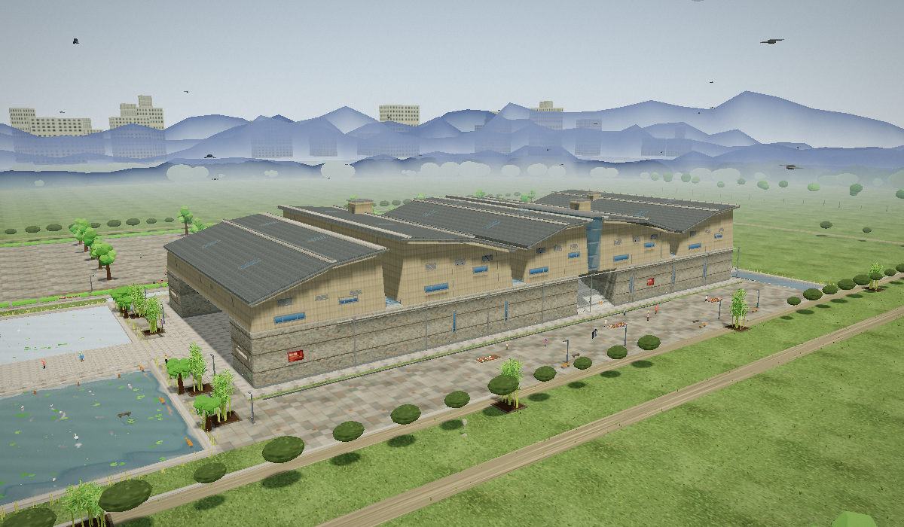

# 宁波博物馆 · 卡通三维场景（单文件网页）

**在线直接玩**：https://nyan936.github.io/ningbo-museum/  ·  **仓库**：https://github.com/nyan936/ningbo-museum



王澍 / 陆文宇 · 业余建筑工作室，宁波历史博物馆（2008 年开馆，2012 年普利兹克奖代表作之一）的
程序化三维还原：**单文件 HTML，双击即开，零外部请求**（Three.js 与全部贴图都内联/程序化生成）。

- 交付物：`dist/ningbo-museum.html`（约 660 KB）
- 源码：`src/*.js` + `src/shell.html`；构建脚本：`tools/build.sh`

## 打开与操作

双击 `dist/ningbo-museum.html`（或浏览器里 `file://` 打开）。

| 操作 | 说明 |
|---|---|
| 拖动 / 滚轮 | 自由环视、缩放 |
| 底部「时刻」滑块 | 0–24 时连续改变太阳高度与方位（清晨 / 正午 / 黄金时刻 / 入夜 / 深夜有快捷按钮） |
| 右侧机位 | 全景 / 裂口 / 山谷台阶 / 瓦爿墙 / 水岸 / 屋脊 / 鸟瞰 / 夜色 |
| 开关 | 自动环绕、游客、卡通描边、水面倒影、阴影、泛光、高画质 |
| 快捷键 | `O` 自动环绕、`H` 隐藏面板 |
| URL 参数 | `?hour=17.7&cam=portal&ui=0&orbit=1&outline=0` 便于分享指定状态 / 自动截图取证 |

打开后画面本身就在动：水面涟漪与倒影、草与芦苇风摆、荷叶起伏、锦鲤绕圈、飞鸟盘旋、
游客往返行走、木船摇晃、它山堰跌水、云飘、昼夜光照推进。

## 场景里有什么（依实拍资料还原的设计要点）

- **主体量体**：144 × 65 × 24 m；三层起裂开成**五个量体**，屋面交错起坡拼成锯齿状山脊
- **瓦爿墙**（下部直壁）：回收青砖横砌 + 瓦片竖砌成带 + 碎缸片 + 龙骨砖拱 + "福壽"铭文砖；
  贴图一张覆盖 3.0 × 3.0 m，青砖按约 240 × 55 mm 的真实尺码画（1 px ≈ 2.9 mm）
- **竹条模板混凝土**（上部斜壁）：竖向竹纹（竹竿约 8~10 cm）、竹节、模板拼缝、**对拉螺栓孔**、
  雨水冲刷痕与底部青苔
- **西端大裂口**：28 m 宽、净高 = 基座高，贯穿进深；上部量体跨越其上（桥式），裂口内退 14 m 是玻璃幕入口
- **南面"山谷"大台阶**：14 m 宽峡谷、30 级踏步自地面升至 10.5 m 平台（仿《溪山行旅图》的正观）
- **三面环水**：西侧人工湖（含**它山堰**复制——可走人的堰顶、跌水石级、木桩列、三处过水缺口）、
  北侧水带 + 堰桥通道、东侧水带；卵石滩、芦苇、荷叶与荷花、锦鲤、小木船
- **平台与小景**：量体之间的天光缝（玻璃采光顶）、绿化小景、点景方亭与景石、压顶与落水管
- **场地**：回收砖铺装广场与树阵、前庭、草坪与割草条纹、绿篱、道牙、长椅、路灯（夜间亮）、展旗、
  台阶上的猫、广场鸽、卡通游客
- **远景**：三层水墨远山 + 山脚树带 + 北面（城市方向）现代天际线 + 渐变穹顶、日月、星空、流星、卡通云

## 技术要点

- 全部几何程序化生成（`prismG` 棱台基元负责"斜壁/坡屋面"，uv 按真实米数计算，所以"贴图覆盖 3 m"可以写死）
- 卡通观感：`MeshToonMaterial`（4 级灰阶）+ **深度/法线双通道屏幕空间描边**（法线通道用
  `MeshNormalMaterial` 覆盖渲染单独一张 RT，天空/远山/水面/草木在其中隐藏）+ 泛光 + 调色
- 水面：一个 `Reflector` 承载五块水面（一次额外渲染），自写 shader 做菲涅尔 + 水体本色下限 + 双层涟漪 + 日月碎光
- 自检 API（控制台可用）：`__SCENE__.setHour(h)` / `jumpCam(name)` / `stats()` / `sample()` / `regionMean(x0,y0,x1,y1)`

## 构建

```bash
THREE_DIR=/home/nyan/.hermes/hermes-agent/node_modules/three \
ESBUILD=/home/nyan/.hermes/hermes-agent/node_modules/.bin/esbuild \
bash tools/build.sh src/main.js dist/ningbo-museum.html
```

## 资料出处（设计依据）

- [宁波博物馆 — 维基百科](https://zh.wikipedia.org/zh-hans/%E5%AE%81%E6%B3%A2%E5%8D%9A%E7%89%A9%E9%A6%86)：主体 144×65×24 m、三层起裂成五部分如山体、
  瓦爿墙（青砖/龙骨砖/瓦片/缸片、明清旧砖、"福壽"铭文）、竹条模板混凝土、入口人工水域与它山堰复制、
  宋代山水画笔意与大台阶
- [中國建築師王澍設計 – 寧波歷史博物館（準建手札）](https://forgemind.net/media/%E4%B8%AD%E5%9C%8B%E5%BB%BA%E7%AF%89%E5%B8%AB%E7%8E%8B%E6%BE%8D%E8%A8%AD%E8%A8%88-%E5%AF%A7%E6%B3%A2%E6%AD%B7%E5%8F%B2%E5%8D%9A%E7%89%A9%E9%A4%A8-ningbo-history-museum)：
  直壁用瓦爿墙、斜壁用清水混凝土；每平方米约 100 块旧砖瓦、瓦爿墙面积约 1.3 万 m²
- [Wang Shu's Ningbo History Museum built from the remains of demolished villages (Dezeen/YouTube)](https://www.youtube.com/watch?v=lgSvdJxAy_0)：
  竹模板在混凝土上留下的纹理、回收材料与新材料的直接并置
- [Design Philosophy: Wang Shu — I Hate Perfect Things](https://blakecrosley.com/blog/design-philosophy-wang-shu)：瓦爿（wapan）干砌工艺的来历

## 用户标注问题修复（第四轮）

| 现象 | 根因 | 修法 |
|---|---|---|
| 百叶撞进窗户 | 百叶 y=0.62h′ 与窗 y=0.66h′ 同一高度带、x 也重叠 | 窗改到 0.30/0.56h′，百叶抬到 0.80h′ 并缩小 → 高度带彻底分开 |
| 屋面小体量卡进屋面 | 屋面沿 x 起坡（5m 宽内高差可达 1.2m），小体量却是水平盒 | 以踏面内屋面**最低点**为底、高度再加整段落差 → 高侧自然埋进屋面 |
| 金属条浮空 | 封檐板做成水平，却放在坡屋面中段高度 | 封檐板随屋面坡度 `rotateZ(roofAng)` |
| 堰体像围栏 / 跌水块像漂着的木料 | 两排 1.5m 木桩 + 3 块分离的跌水梁 | 重做：条石压顶 + 4 级贯通全宽、彼此相接的跌水石级 + 只留一排 0.72m 护堰桩 |
| 水面白色浮盘 | 涟漪环/泡沫过大过亮 | 环 0.38→0.13 不透明度、半径增长 6.0→3.4；泡沫 1.5→0.85、0.42→0.20 |
| 人物"腿部分家" | `dz = s*stride + s*0.095` → 两腿在 z 向拉开 0.59m，而躯干只有 0.235 深 | 两腿并排（x ±0.095），迈步只在 z 向 ±0.13；坐姿游客精确落在长椅位 |
| 树冠浮在树干上方 | 树干只到 0.38h，树冠从 0.48h 起 | 树干 0.46h + 3~4 根主枝插进树冠 + 树冠最低档压到干顶以下 |
| 路灯不亮 / 光源处不亮 | 灯罩玻璃被 translate 到 **y=0.06（地面）**，灯头里是空的 | 灯罩移到灯头内（y≈4.5）、加宽到 0.5m 从灯头下缘露出 |
| 广场铺装像长条木板 | 铺装贴图行高大于列宽 + 暖色点缀，掠射角下横缝糊成条纹 | 改规整 1.5m 石板网格（双向同宽深缝）、降对比与暖色点缀、6m 大分格缝 |

## 用户标注问题修复（第五轮）

| 现象 | 根因 | 修法 |
|---|---|---|
| **所有屋顶悬空** | 屋面是单向起坡，而量体墙顶停在"低端高度"（平顶）→ 高端屋面比墙顶高出最多 6.4m，中间是空的 | 给 `prismG` 加 **ty0/ty1 斜顶**能力，让墙顶沿 x 起坡并插进屋面下皮 0.12m；同时按"现场结构"补：**檐下椽子**（每 1.35m 一根、从墙里伸到檐口）+ **两道斜檐檩** + 山墙分缝按各自端头墙高重算 |
| 光源重面/像闪 | 洗墙灯是 0.24m 立方体，悬在离墙 0.62m、离地 0.6m 处，又被描边勾出黑边 | 改成**贴墙横向条形灯槽**（深色灯体 + 0.06m 厚灯罩）并放进 `hideDuringReflect`（不参与描边法线通道） |
| 招牌没有连接线 | 旗面被放在立杆旁 0.56m 处，没有任何连接件 | 补**上下横臂 + 抱箍**，旗面贴到立杆上 |

## 用户标注问题修复（第六轮）

| 现象 | 根因 | 修法 |
|---|---|---|
| 窗户/金属栏珊"浮空"没贴建筑表面（图7） | 量体是**斜壁**（内收 6.5°），而窗、窗棂、百叶、竖向分缝全按"垂直墙面"摆在固定 z 上 → 越高离墙越远（10m 高处差近 1m） | 新增 `faceZ(y, side)`/`faceAttach()`：按该高度算墙面 z 并让构件随斜壁倾斜（`rotateX(±6.56°)`）；山墙端面同理按 `rateX` 算 x 与 `rotateZ` |
| 露台栏杆浮在墙外（图7） | 栏杆按"垂直墙"摆在 zS−0.8，而斜壁在 11.3m 高处已内收 0.56m | 栏杆 z 改由 `zS − T − (高度−yBase)·0.115` 计算，落在斜壁内侧 |
| 屋面天窗条"卡进屋顶"（图5） | 天窗放在屋面基准面 +0.30，而屋面板上表面在 +0.46 → 整条埋在板里 | 抬到 +0.56，并按**所在坡段**的角度旋转、避开折脊（t=0.24 / 0.78） |
| 金属条斜的且浮空（图6） | 挑檐 1.3m，封檐板/檐檩离墙太远像悬在空中 | 挑檐收到 0.55m，封檐板/檐檩/椽子全部贴到檐口；椽子从墙里伸出（可见结构） |
| 牌子/展板骑在石线脚上（图3/图4） | 馆名牌 y=5.8、展板 y=3.5，都跨过 3.5/6.7m 的花岗岩线脚 | 馆名牌 → 5.05、展板 → 5.1（落在两线脚之间的空档） |
| 树、灯在路中间（图1） | 垂柳随机 z 落进堰顶通道；西前庭路灯立在广场正中；地埋灯柱/系缆桩有两根落在堰顶 | 垂柳避开 z∈[-11,11]；路灯移到广场西缘；灯柱/系缆桩避开堰顶段 |
| 默认体验 | — | **默认关闭自动环绕与卡通描边**（按钮仍可开） |

## 用户标注问题修复（第七轮）

| 现象 | 根因 | 修法 |
|---|---|---|
| 「同一个面贴图有两个角度」（图1） | `prismG` 的侧面 UV 是按"四角铺 0..1"给的，而量体墙顶是**斜顶**（跟着屋面）→ 整张贴图被**剪切**，水平模板缝变斜线；相邻体量斜向相反就更明显 | 改成**逐顶点世界坐标平面 UV**（侧面 u=水平轴、v=y；顶/底 u=x、v=z）→ 水平缝恒为水平、竖纹恒为竖直、相邻体量也对齐 |
| 「金属条应沿屋顶折线，不是直线浮空」（图2） | 封檐板/檐檩按**一条直线**（低端→高端平均斜率）做，而屋面在 58% 处**折了一次**（折点高 1.15m）→ 折点附近偏离屋面约 1m | 檐檩/封檐板/椽子全部**按两个坡段各做一段**，随折线转折 |
| 「灯具悬空了」（图3） | 雨棚筒灯放在雨棚底以下 0.22m、门厅灯带放在顶棚以下 0.4m，中间没有连接件 | 筒灯改成"灯体嵌进雨棚 + 灯罩露出下缘"；门厅灯带抬到顶棚下 0.06m 贴住 |
| 顺带 | 改 UV 时曾把顶/底面的 v 误用 y（常量）→ 所有水平板（屋面/铺装/平台）被拉成单行条纹 | 已修：顶/底 u=x、v=z；航拍确认铺装网格与瓦垄方向恢复正常 |
| 顺带（严重） | 改 UV 时把 north/east 两个面的**顶点顺序也改了 → 绕序反了 → 被背面剔除**，整片墙消失（只剩屋顶与栏杆） | 恢复原绕序、只保留 UV 变化；南/北/东三个立面分别复核确认完整 |

## 用户标注问题修复（第八轮）

| 现象 | 根因 | 修法 |
|---|---|---|
| 「窗户？还是什么」——墙上几块空白灰板 | 斜壁窄窗原为 6.5×1.15m 大玻璃盒 + 一圈同色深框，远看就是一块灰板；玻璃也太暗 | 改成**窄缝窗**（5.2/3.4 × 0.95m）：深色洞口 + 亮色上下压条 + 玻璃（提高反射感）+ 两道竖梃，并保留窗台；基座竖缝窗同步收窄 |
| 「有问题」——体量缝隙里一排悬空木块 | 檐下椽子长 1.15m、中心在墙外 0.26m → 端头伸出屋面轮廓 0.285m；檐檩两端也多出 0.35m | 椽子收到 0.86m、中心 0.14m；檐檩长度 −0.7m —— 全部收在 0.55m 挑檐之内 |
| 墙顶小灰盒突兀 | 滴水嘴 0.62×0.34×0.5m、外挑 0.26m | 缩到 0.34×0.22×0.3m、外挑 0.16m |

## 用户标注问题修复（第九轮）

| 现象 | 根因 | 修法 |
|---|---|---|
| 「窗户你只修复了部分吗」 | 第八轮只重做了**斜壁上的横向条窗**；**直墙（瓦爿墙）上的竖缝窗**仍是"玻璃盒 + 同色深框"→ 远看就是一根黑竖条 | 直墙竖缝窗改用同一套做法：深色洞口框 + 亮色压条 + 玻璃 + 3 道横向分格；并把**东、西立面各一条**同规格竖缝窗一并补齐（东西面原本只有裸玻璃盒） |

## 第十轮：agy 独立审查（自主读码 + 自主截图 + 自主看图）与修复

审查方式：把版本冻结到 `releases/ningbo-museum-v9-20261013-0943.html`，由 **agy**（Antigravity CLI，`tools/agy-review.sh`）在 headless 下自主完成——
自己读 `src/*.js` 全部源码、自己跑 `tools/shoot.mjs` 拍 11 个机位 + 2 张 1600×900 贴脸、自己写 `review/inspect.mjs` 探针（Mesh/材质/贴图/开关/机位/时刻边界）、逐张看图，最后写 `review/agy-report.md`（285 行）。

### 已修（按核实结果）

| 编号 | 严重度 | 问题（agy 结论 + 我的核实） | 修法 |
|---|---|---|---|
| C1 | **P0** | `props.js:726` 把 `BufferGeometry` 直接 `group.add()`：**全场景垃圾桶 100% 丢失** + 控制台常驻 `THREE.Object3D.add` 报错（我独立复核确认） | 改为 `add(meshOf(mergeGeos(bins), …))`；并把"无头运行无控制台错误"加进 `tools/check-scene.sh` 门禁 |
| V3 | P1 | 瓦爿贴图 3m × 48 次重复 → 机械阵列感（复核确认） | 贴图 1024→**2048px 覆盖 6.0m**（像素密度不变、砖层高仍 6.4~8.8cm），行高不跟着放大；`UX 3.0→6.0` |
| V4 | P1 | 南面山谷大台阶尽端上方（V3/V4 之间的缝）**漏天漏山**，峡谷读成穿堂（复核确认） | 缝上补 7.4m 高**玻璃幕 + 横竖分格**，峡谷恢复内聚 |
| V5 | P1 | 水面接触压暗 0.80/0.78 过重 + 掠射角只剩反射 → 近岸读成水泥（部分确认，agy"大面积死黑"夸大） | 压暗改 0.89/0.88 且过渡 3m；掠射角天空混合 0.05+0.15·f²·⁵ → **0.10+0.28·f²**；涟漪环 0.35 白 → 0.16 冷白 |
| V6 | P1 | 夜里远山上方一片发白 + 远景高楼没有灯火（复核确认） | 云的夜间系数 0.34→**0.10**；城市加 `emissiveMap`（约四成窗随机点亮）+ `emissiveIntensity = nightF×1.15` |
| V8 | P2 | 墙顶滴水嘴像"外粘悬空方块" | 滴水嘴下方补一道连续**檐沟**（13m 一段、0.36m 宽） |
| V9 | P2 | 屋面天窗共用 `matGlass`，夜里变成**橙色荧光条**（复核确认） | 新增 `matGlassRoof`（无夜间暖光自发光） |
| V10 | P2 | 竹子直接从地砖里长出来、竹叶太稀（复核确认） | 每丛补**花岗岩树池 + 种植土**；竹叶 26→**40 片** |
| C3 | P1 | `sky.js` 里遗留 122 行**巴黎/埃菲尔铁塔**死代码（复核确认：真正的 horizon 在 `horizon.js`） | 整段删除，文件头注释同步更正 |
| C4 | P1 | `base.js` 的 `pavingTexture/stoneTexture/roofTexture` 无人引用、`glassSheenTexture` 与 `surfaces.js` 重名（复核确认） | 全部删除，程序化贴图收敛到 `surfaces.js` |
| C5 | P2 | `main.js` 补光灯每帧 `camera.position.clone()` → GC 抖动 | 改静态复用 `_fillDir/_up70` |
| C7 | P2 | `post.js` 手工逐项拷相机矩阵，易漏（`fov/zoom/layers`） | 改 `normalCam.copy(camera)` |
| 风格 | P1 | 三道明亮石线脚 + 深色落水管把瓦爿墙切成"笼子"（agy V2 + 我同意） | 线脚 0.22 厚/外挑 0.11 → **0.13/0.06** 并换偏暗花岗岩 `matCourse`；落水管外移 0.12m 避免与线脚实体穿插 |
| 我的补充 | P1 | 屋面瓦垄 12 垄在 1.8m 内读成细密噪点 | 改 9 垄、拉开对比 |

### 复核后**驳回**的结论（附证据）

| agy 结论 | 实际 | 证据 |
|---|---|---|
| **V1/F2**：斜壁百叶叶片"全部埋进墙内、退化成空框" | **误报**。叶片中心在 `zz+sgn·0.06`（凹入框内 6cm、外露 3cm），是"叶片凹进深框"的正常做法；1600×900 贴脸图里百叶读作深色格栅，不是空框 | `review/shots-highres/09-closeup-wall.png` |
| **性能表**：Draw Calls "40~60，优秀 <200" | **错**。实测 `renderer.render(scene,camera)`：**944 calls/帧**（主 pass ≈450 + 阴影 pass ≈450）；46 万面 441 mesh | 页面内 `renderer.info` 实测 |
| "首屏 300ms 完成" | **错**。本机（含 SwiftShader）首次构建 15~25s：44 张 Canvas 贴图 + 46 万三角面 + PMREM | 实测加载计时 |
| 贴图精度与体积的权衡"要多花 200~300KB" | **不成立**。程序化 Canvas 贴图是运行时生成的，不进 HTML 体积（只多几十行代码/1KB 级 + 显存） | `surfaces.js` 全部为 `canvasOf()` 生成 |
| V5"水面大面积死黑" | 夸大：原为 2m 内压暗 20~22% | `water.js` 原式 `mix(0.80,1.0,smoothstep(0,2,…))` |

### 第十一轮：按用户要求"不考虑性能，把剩下的都做掉"

| 项 | 做法 |
|---|---|
| 瓦爿贴图周期（agy V3 的加强版） | 2048px/6m → **4096×2048px 覆盖 12.0m × 6.0m**（像素密度不变），144m 墙面重复 **48 → 12 次**；`UX/UY = 12/6`。修正过程中发现并修掉一个真 bug：龙骨砖那段路径仍在用画布尺寸 `w/h`（4096/2048）而不是砖尺寸 `bw/bh2`，会画出几米大的橙色拱形 |
| 场地边缘"刀切"（agy V7） | 新增 `gravelTexture()`；铺装外沿补**碎石过渡带（3.2m）→ 灌木带 → 4m 园路**，再加两排行道树与外围树列 |
| 场地外 100~500m 的"无限绿毯" | 中景新增 **20 处远景林地**（每处 10~18 棵简化树）+ **6 条田埂/防风林带** + **6 片田块色差** |
| 广场正中那排绿篱（agy V11） | 从 x=−136/−80（正好杵在广场中间）移到 x=−166（西缘） |
| 涟漪环位置（agy C6） | 不再假设 `z0 = −z1`，改按 `sgn` 取 `z1/z0` |
| 新增机位 | **漫步**（行人视高 1.65m，沿山谷轴线），UI 里也加了按钮 |

### 第十二轮：agy 第二轮全盘审查（针对 v11）后的修复

审查产物：`review/agy-report-2.md`（240 行，含 13 张自截图坐标 + file:line）。**关键：它指出我上一轮把 V1/C2 判为误报是错的**——我用染色探针（`tools/probe-color.mjs`：把窗玻璃染成品红、框染成青、墙染成黄）复核，**确认墙上 8 个窗框里只有 1 个能看见玻璃**：`zz - sgn*0.02` 让玻璃与墙面同面被墙体吃掉；百叶叶片同样被实心框+墙吞掉。我上轮的"驳回"是坐标语义推错，**是我的错**。

| 编号 | 严重度 | agy 结论（复核后） | 修法 |
|---|---|---|---|
| **N1** | **P0** | 大台阶 30 级 × **35cm/级**（膝盖高，不可攀） | 改 **63 级（3×21）× 16.7cm**（公共建筑 13~18cm），踏面 35cm；`stairY()` 与台阶行人自动跟随 |
| **V1/C2** | **P0** | 斜壁窗/百叶"空框"——玻璃与叶片被墙体吞掉 | 重写为**由外向内分层**：压条 → 框 → 玻璃 → **暗底板**（新 `matDeep`），并抽出 `outAt(y,sgn,d)` 显式"向外"辅助函数，杜绝 `±sgn` 语义歧义（我连续踩了两次） |
| **N2** | **P0** | 山谷尽端玻璃幕只到 18.2m，上方还漏 4.8m 天空 | 幕高 7.4→**13.4m**（顶到屋脊 ~24.5m），加 5 道横梃与**顶部过梁** |
| **N3** | **P0** | 落水管外移后离墙 14cm 悬空、无抱箍、顶部不接天沟 | 移到离墙 0.07m；**每 ~2.9m 一道抱箍**（含竖向扁钢）+ 顶部**接水斗** |
| **N4** | P1 | 漫步机位正前方被一根路灯贴脸挡住 | 南广场路灯生成时 `if (Math.abs(lx-13.6) < 9) continue` |
| **N5** | P1 | 它山堰两端 57cm 直落，像悬空石唇 | 两端各补 **3 级上岸台阶**（0.19m/级，从堰顶 0.62 落到场地 0.055） |
| **N6** | P1 | 4m 园路在草坪上断头 | 补东西两段，**闭合成环路** |
| **N7** | P2 | 窗洞太平，缺"城堡深凹窗"的进深 | 洞口框外挑 0.26m 深、压条外挑 0.21m、玻璃在 0.10m、暗底在 0.015m → 形成真实凹洞层次 |
| **N8** | P2 | 中景田块是 90° 直角矩形贴纸 | 改 **14 边随机抖动多边形**（ShapeGeometry） |
| 工具 | — | — | 新增 `tools/probe-color.mjs`（材质染色探针）；`check-scene.sh` 增**踏步高 13~18cm** 断言 |

agy 本轮还主动修正了它自己上一轮的 Draw Call 口径（实测 900+ ✓ 与我的测量一致），并把"draw call 不合并 / 上部量体不建室内 / 远山用水墨圆环 / 水面掠射角细亮条"列为**合理取舍、建议不改**。

### 仍待办（P3，非必须）

1. **Draw calls ≈950/帧**（主 pass + 阴影 pass）：用户明确说不用管性能，未做合并优化。
2. 水面极掠射角仍会看到细亮反射条（涟漪扰动把亮部拉成细线），属实时反射的固有现象。
3. 瓦爿贴图若还想再打散，可上 A/B/C 三张交替（`surfaces.js` 已是参数化生成，改动很小）。

## 已知取舍

- 建筑内部未建模（仅裂口内退处的入口门厅可见）；量体为便于阅读做了几何简化（五个量体、两段折坡屋面）
- 远景城市/远山为写意层，不是地理精确位置
- 卡通描边做了**深度衰减**（320–640 m 外不描边）：否则远山的剪影会在地平线处被描成一条横贯画面的粗黑带
- 在 GTX 940MX 上 1500×897 约 26–31 fps（真 GPU）；弱显卡可关"卡通描边 / 水面倒影"或切"高画质"关闭

## 细节清单（可对照源码）

- **建筑**：瓦爿墙三道花岗岩分层线脚、墙顶滴水嘴、12m 竖向分缝、落水管、斜壁**百叶通风口**、竖缝窗分格、
  檐口**瓦当** + 封檐板、折脊**正脊瓦** + 压脊石、两端山墙分缝、**屋面采光天窗条**、**屋面小体量与风帽**、
  墙面**临展海报板**（6 处）、外墙铜牌、东立面服务门与设备箱
- **裂口/门厅**：玻璃幕 + 钢竖梃 + 雨棚与筒灯、门厅顶部**灯带**与点光源、**展板**、接待台、铜牌、石球、
  入口围挡、地埋射灯、内壁洗墙灯
- **场地**：馆名墙、导览图牌、一柱三板指示牌、垃圾桶、石凳、长椅、花池花丛、地埋灯柱、
  无障碍坡道与栏杆、排水明沟、广场 6m 大分格铺装与中轴铺装带、树阵树池、绿篱、展旗、
  北水带**汀步**（两岸带接驳平台）、东水带**石拱桥**、**水线卵石带**、系缆桩
- **水岸生灵**：荷叶/荷花/浮萍、锦鲤、**白鹭**、芦苇、地埋灯柱、木船
- **夜景**：基座**洗墙灯**（北/南/西三面）+ 台阶灯带 + 平台边沿灯带 + 路灯 + 展旗灯 + 窗口暖光 + 门厅点光源

## 验收记录

- 两台独立子代理各做了一轮"自己渲染 + 亲眼看图 + 像素/射线取证"的审查（review-only，未改文件）：
  - 第一轮抓出 10 条缺陷，其中致命两条：水岸高差（水面/池底/铺装三者不对齐）与黄金时刻—夜景曝光层级倒挂
  - 第二轮逐条判定：水岸几何、水中构件判读、黄金时刻曝光、夜景倒挂 **4 项已修复**；屋面、远景、描边副作用按第二轮意见再修一轮（屋面重做为强化"瓦垄分垄+瓦头收边"、远山改 4 层 + 山脚顶点 alpha 渐隐、描边加深度衰减）
- **第三轮（重面专项 + 细节）**：审查员用"零运动基线"（同机位连拍两帧全屏 1,345,500 像素差值恒为 0）逐个探测 11 处可疑共面点，结论 **全部已消除、无闪烁**（`speckle = Δ>64 且 8 邻域全 <20` 的孤立翻面数：平台面 52/1.35M 且 dy=0 时归零、折脊 1、水岸 22063 但全为水面整体变化、其余 0）；并点出坑位：我删掉了量体底面（与平台顶棚共面）、裂口内那块只差 2cm 的铺装、给水底盘各块错开 12mm、给广场铺装加 6m 大分格缝、把长条构件从 `boxG`（uv 0..1 → 贴图被拉成几十米）改成按真实米数算 uv 的 `prismG`
- 自检数据（1500×897，940MX）：天亮/正午/16.4/黄金时刻/夜晚五档 `blackPct` 分别 0.05 / 0.03 / 0.02 / 0.21 / 1.83%，`overPct` 全程 0；`__ERRORS__` 为空；`list_network_requests` 只有 1 条（HTML 自身）；~44 万三角形 / 423 mesh / 21–31 fps
- 构建可复现：同源码 rebuild 后 md5 一致；`tools/check-scene.sh` 全部通过

